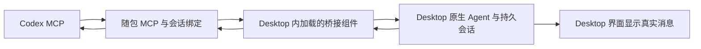

# 内置 Desktop 通信组件：实施与验证

记录日期：2026-10-18。开发版本：0.3.0-preview.1。此记录描述本地已验证的改造，不代表旧版 GitHub 安装包已自动更新。

## 选择直接集成源码

用户提出使用 [REA](https://github.com/morluto/rea) 分析 Crew 或直接封装。REA 能分析 JavaScript/Electron 模块与运行关系；Crew 本身已提供源码与 MIT 许可，因此本次直接阅读和改造公开源码，没有安装 REA、反编译原生程序或修改 DSH Desktop 应用本体。

这是基于 [DSH Crew](https://github.com/ZSeven-W/dsh-crew) rc.14 的衍生集成。保留 ZSeven-W 的版权、完整 MIT 许可与原始归档；不把上游代码称为本项目原创。归档与校验依据见 [第三方声明](../THIRD_PARTY_NOTICES.md)。

## 这次解决的问题

0.2 版从 Desktop 单独安装的 Crew 目录导入代码，且借用 Desktop 的 Web 服务。Crew 总开关关闭、新版 Desktop 仅运行本地界面时，原连接无法正常工作。

0.3 在安装时直接校验并展开随包源码；固定版本的源码、许可和修改后的会话组件都留在 Desktop 的 `codex-bridge` 目录。MCP 从该目录运行内置的上游 MCP bundle，保留其委派来源限制与目录互斥。会话组件直接调用 Desktop 已加载的 Agent/会话服务，并提供自己管理的 localhost 通信端口，不需要 Web 客户端或额外 Agent Runtime。

默认端口 19387。只绑定 127.0.0.1，检查 Host 并拒绝浏览器 Origin/Fetch 请求，不打开远程访问。原 Crew 后台组件保持关闭，不自动重新启用 Crew 插件；桥接组件不挂载上游的安装器、进程控制与多模态设置接口。单独安装的 Crew 源码、其他插件、DSH 凭据和聊天历史不被覆盖。

新增代码负责：固定归档校验与本地展开、独立通信端口、配置迁移及回退、每个 Codex 会话的持久绑定、Flash/MAX 限制。Agent 执行与会话持久化仍由 DSH Desktop 提供；上游 MCP 和部分工具函数仍来自注明出处的 Crew。

## 本机实测

- macOS Apple Silicon，DSH Desktop **0.2.1-rc.2**。
- 在 Desktop 插件页关闭整个 `@zseven-w/dsh-crew` 开关，并退出、重启 Desktop；重启后 profile 的启用 bundle 列表不含 Crew。
- 原 `dsh-crew-hub` 保持 disabled；桥接自己的组件成功加载，健康检查返回 `implementation: bundled-desktop-bridge`、`crewPluginRequired: false`、`extensionVersion: 4`。
- 保持当前 Codex 聊天的真实 conversation_id 与原 desktop-smoke-workspace；未创建替代聊天来绕过错误。

| 实际任务 | Job ID | 结果 |
| --- | --- | --- |
| 记住新测试词，只回复“已记住” | hub-1-mvd2px8s | done，回复“已记住” |
| 不重发测试词，要求回忆 | hub-2-mvd2q9rv | done，回复“松石-4827” |

两轮的实际 sessionId 都是 `session-6855d62f-085e-2c1c-3dc3-c9396be56d21`，与本聊天之前的原会话一致。完成结果均为 `continued: true`、`deepseek-official/deepseek-flash`、`effort: max`、`toolCalls: 0`、`error: null`。本次不是只验证了提交响应，Codex 已分别取回最终结果。

用量字段按服务实际返回记录：第一轮 input=17944、output=3、cacheRead=0；第二轮 input=195、output=6、cacheRead=17792。这里只记录原字段，不把它推算成固定节省比例或未来保证。

原生界面验收：Desktop 的 desktop-smoke-workspace 下，原聊天“记住测试暗号银杏-7316”显示新增的两条测试消息及对应回复；UI 显示 Flash、Max。聊天标题沿用历史标题，不是新开会话。

## 自动测试

`node scripts/prepare-tests.mjs && node --test tests/*.test.mjs`：**16 通过，0 失败**。

包括未安装 Crew 的隔离安装与重复安装、无关设置和 YAML 标签保留、旧版端口覆盖迁移、归档或缓存被修改时拒绝安装、不依赖 host webServer 的服务启动、错误 Host/浏览器来源拒绝、端口冲突不终止占用者、关闭后释放端口、同会话续聊、不同聊天隔离、宿主持久化恢复及手动回合忙碌保护。

## 使用与回退

本机已迁移到这套实现，Crew 插件总开关保持关闭。旧安装位置的备用 desktop_task.py 助手也已跟随当前注册的 Desktop 适配器，仍使用真实 CODEX_THREAD_ID。Codex 重载连接后可直接使用 dsh_desktop_crew。

新电脑先安装并初始化 DSH Desktop，然后运行本版“安装与配置”，退出并重开 Desktop/Codex。无需先安装 Crew 插件。安装前会备份 profile patch、Codex MCP、委派规则、旧扩展和设置；若写入失败会回退配置。原凭据不复制进本项目。

手动回退时先等任务结束、退出 Desktop，只恢复本次相关备份；不要覆盖备份之后的其他修改。安装器不会杀死端口占用进程。卸载默认保留会话、凭据、备份和 profile 内持久组件，彻底移除通信入口需另外移除该桥接插入项。

## 尚未验证与限制

- 本次实际模型验证为两轮短文本；未额外委派文件编辑、取消长任务、复杂工具或多模态任务。
- Windows 共用代码与封装入口已调整；本轮不构建 Windows 包，不声称 Windows 安装或实际任务验证通过。
- Intel Mac 只保留通用构建目标，未实机运行。
- 通信组件仍依赖 DSH 的插件服务 API；未来 DSH 改动仍需兼容性验证。Crew 衍生源码虽已内置，并未变成独立重写的 Agent 引擎。
- 任意分支的自动识别、摘要自动生成，以及从外部主动唤醒 Codex，仍未实现。Desktop 重启后旧 Job 内存记录可能消失，聊天历史由 Desktop 持久化。
- 历史 0.2 发布包保留原样；本次开发分支与本地预览包的发布状态以实际 GitHub 状态为准。
